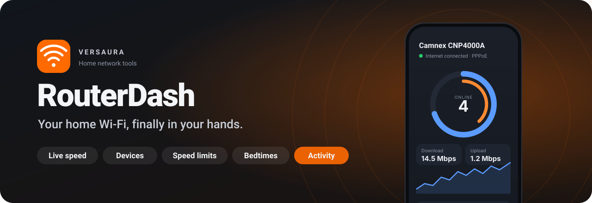
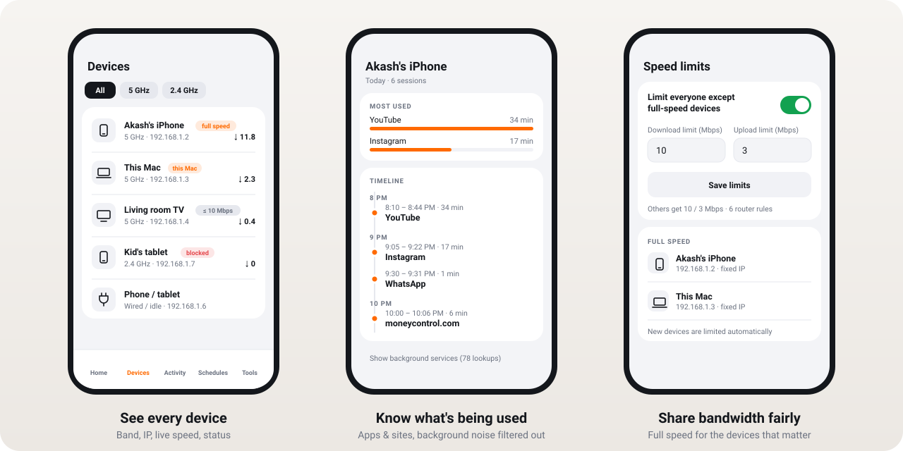
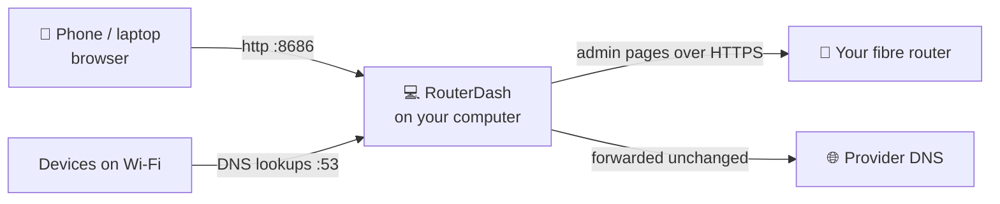

<div align="center">



<br>

**See who's online, control how fast, decide when, and know what's being used.**<br>
A beautiful dashboard for the fibre router your internet provider gave you. It runs on your own computer, with no cloud and no account.

<br>


[**Get started**](#-get-started-in-2-minutes) · [Features](#-what-you-get) · [Will it work with my router?](#-will-it-work-with-my-router) · [FAQ](#-good-to-know)

</div>

---



## ✨ What you get

| | |
|---|---|
| 📶 **Live speed** | Download and upload right now, plus a running graph and the busiest devices |
| 📱 **Every device** | Name, band (2.4 / 5 GHz), signal, IP, link speed, data used, time online |
| 🚦 **Speed limits** | Everyone gets a fair share by default, and the devices you choose get full speed |
| 📌 **Fixed IPs** | Pin a device to one address so rules always follow it |
| 🌙 **Bedtimes** | No internet for the kids' tablet on school nights, enforced by the router itself |
| ⛔ **One-tap block** | Cut a device off instantly, and undo it just as fast |
| ⏰ **Wi-Fi schedules** | Turn 2.4 GHz or 5 GHz off at night and on in the morning, plus weekly auto-restart |
| 🕵️ **Activity history** | "YouTube 8:10–8:44 PM, Instagram 9:05–9:22 PM" for each device, with system noise filtered out |
| 🔀 **Port forwarding** | Open ports for a NAS, camera or game server |
| 🚫 **Website blocking** | Block a site for the whole house |
| 📲 **Works on your phone** | Add it to your home screen and it feels like an app |

## 🚀 Get started in 2 minutes

You need a computer that stays on at home (a Mac, a Linux box or a Raspberry Pi) with [Node.js 18+](https://nodejs.org).

```bash
git clone https://github.com/Versaura/routerdash.git
cd routerdash
npm install
npm run check     # 30-second test: is my router supported?
npm start
```

Then:

1. Open **http://localhost:8686** and enter your router's admin username and password. They're the same ones you use for its web page and are often printed on the sticker underneath.
2. Choose a 4–8 digit **app PIN**. It keeps others on your Wi-Fi out of the dashboard.
3. On your phone, open the address the terminal prints (`http://192.168.x.x:8686`), then tap **Share → Add to Home Screen**.

<details>
<summary><b>Keep it running all the time</b> (recommended)</summary>

<br>

```bash
npm install -g pm2
pm2 start server.js --name routerdash
pm2 save && pm2 startup      # run the command it prints
```

Schedules and activity history only work while RouterDash is running. Stop your computer sleeping when it's plugged in, or run RouterDash on a Raspberry Pi.
</details>

## 🧭 Will it work with my router?

RouterDash talks to the router through its own admin web pages. It works with fibre routers (ONTs) built on **Realtek chipsets** that use the classic Realtek admin interface. Many internet providers hand these out under different brand names.

| Status | Routers |
|---|---|
| ✅ **Verified** | **Camnex CNP4000A**, supplied by GTPL (firmware `GTPL_V4.0.1`) |
| 🟡 **Should work** | Other Realtek-based GPON/EPON fibre routers with the same admin interface, often rebranded by the ISP. Not tested yet; run `npm run check` |
| ❌ **Not supported** | Routers with a different interface: most Huawei, ZTE, Nokia, TP-Link, Netgear, ASUS, and Wi-Fi mesh systems |

**Quick ways to tell:**

- The admin page opens at `https://<router-ip>/admin/login.asp`.
- The browser tab says **"BroadBand Device Webserver"**.
- The menu has **Status · LAN · WLAN · WAN · Services · Advance · Diagnostics · Admin · Statistics**.
- `npm run check` prints **Looks compatible**.

> [!TIP]
> Tried it on another router? [Open an issue](https://github.com/Versaura/routerdash/issues) with your model and the `npm run check` output, whether it worked or not. That's how the ✅ list grows.

## 🔎 Feature tour

<details>
<summary><b>🚦 Speed limits: fair sharing, full speed for favourites</b></summary>

<br>

Turn it on in **Tools → Speed limits** and set a default, for example 10 Mbps down and 3 Mbps up. Every device gets that, except the ones you mark **Full speed** on their device page. Any device can also have its own limit.

- Limits are enforced **by the router**, not by your computer, so they keep working even if RouterDash is closed.
- New devices are limited automatically about 30 seconds after they join.
- Your computer is put on the full-speed list for you.
- Turning it off removes every rule RouterDash created.

> [!NOTE]
> Limits follow IP addresses. Give your full-speed devices a **fixed IP** so a new device can't inherit one by accident.
</details>

<details>
<summary><b>🕵️ Activity history: what each device used, in plain language</b></summary>

<br>

```
Akash's iPhone · Today
  8:10 – 8:44 PM   YouTube            34 min
  9:05 – 9:22 PM   Instagram          17 min
  9:30 PM          WhatsApp           briefly
 10:00 – 10:06 PM  moneycontrol.com    6 min
  ▸ Background: Apple services, analytics, ads (412 lookups)
```

Every device looks up website names (DNS) before connecting. RouterDash answers those lookups for your home network, passes each one on to your provider unchanged, and records which device asked for what. A catalog of 130+ apps and services turns raw names like `rr3---sn-ci5g.googlevideo.com` into **YouTube**. Background chatter, such as phone OS services, app analytics, ads, CDNs and WhatsApp's always-on connection, is kept out of the timeline.

**One-time setup on the router:** LAN → DHCP → DNS option → **Set Manually**. Set **DNS1** to your computer's IP and **DNS2** to your provider's DNS. RouterDash shows you the exact values on the Activity tab.

- It records site names, not pages, searches or messages.
- History stays on your computer for 30 days and can be deleted with one tap.
- Devices using iCloud Private Relay, a VPN or "Secure DNS" won't show up.
- Let the people in your home know it's on.
</details>

<details>
<summary><b>🌙 Bedtimes and blocking</b></summary>

<br>

Pick a device, the days and a time window. The rule is saved **on the router** (Parental Control), so it works even when your computer is off. **Block internet** on a device page adds an all-day rule; **Unblock** removes it.

For overnight bedtimes, add two windows, such as 22:30–23:59 and 00:00–06:30. The router needs each window's start to come before its end.
</details>

<details>
<summary><b>⏰ Wi-Fi schedules and auto-restart</b></summary>

<br>

Turn the 2.4 GHz or 5 GHz radio off and on at set times, or restart the router weekly. These run from your computer, because these routers have no built-in Wi-Fi timer. RouterDash won't let you schedule off the band your computer is using, since it couldn't switch it back on. Use a network cable to schedule both bands.
</details>

## 💡 Good to know

<details>
<summary><b>Port forwarding saves but nothing is reachable from outside</b></summary>

<br>

Many providers put homes behind **CGNAT**, which means one public IP is shared by many customers. RouterDash warns you when it sees this, for example when the router's internet IP starts with `10.` or `100.64–127.`. Ask your provider for a public or static IP, or use [Tailscale](https://tailscale.com) or [Cloudflare Tunnel](https://www.cloudflare.com/products/tunnel/), which work behind CGNAT.
</details>

<details>
<summary><b>A phone shows up as "Phone / tablet", or rules stop matching it</b></summary>

<br>

Phones use a random ("private") MAC address per network. Turn it off for your home Wi-Fi so names, limits and bedtimes stay attached:

- **iPhone:** Settings → Wi-Fi → ⓘ next to your network → Private Wi-Fi Address → Off
- **Android:** Wi-Fi → your network → Privacy → Use device MAC
- **Mac:** System Settings → Wi-Fi → Details → Private Wi-Fi address → Off or Fixed
</details>

<details>
<summary><b>I got logged out of the router's web page</b></summary>

<br>

These routers allow one admin session at a time. RouterDash logs back in by itself. If you use the router's own page, RouterDash simply waits its turn.
</details>

<details>
<summary><b>Can it run on the router itself?</b></summary>

<br>

No. Provider routers are locked down, have very little memory, and get updated remotely. A Raspberry Pi or any always-on computer is the right home for RouterDash.
</details>

<details>
<summary><b>macOS says port 53 is refused</b></summary>

<br>

Activity history needs port 53. Run `sudo npm start`, or keep history off. Everything else works without it.
</details>

## 🔐 Privacy and security

- **Nothing leaves your home.** There's no cloud, account, analytics or tracking. It's just your computer and your router.
- Your router password stays on your computer in `~/.routerdash/config.json`, readable only by you. The dashboard is locked with a PIN and locks out for a minute after 5 wrong tries.
- RouterDash never touches firmware, factory reset, admin passwords or your provider's WAN settings.
- Keep the dashboard on your home network. For remote access, use [Tailscale](https://tailscale.com), not a public link.

## 🛠️ How it works



RouterDash reads the router's admin pages and submits its forms exactly the way the router's own web page does, including the checksum the router expects. No hacks and no firmware changes.

## 👩‍💻 For developers

```bash
npm test           # 7 end-to-end tests against a mock router (needs openssl)
npm run check      # compatibility probe, read-only
```

| Read | For |
|---|---|
| [AGENTS.md](AGENTS.md) | Code layout and the rules for changing it, written for people and AI coding tools |
| [docs/ROUTER-NOTES.md](docs/ROUTER-NOTES.md) | Every router page, form field and quirk RouterDash relies on |
| [docs/ARCHITECTURE.md](docs/ARCHITECTURE.md) | Data flow, speed limits, activity history |
| [docs/API.md](docs/API.md) | JSON API and environment variables |
| [CHANGELOG.md](CHANGELOG.md) | What changed |

**Adding a router:** run `npm run check`, then follow *Changing router behaviour safely* in [AGENTS.md](AGENTS.md).

<div align="center">
<br>
<sub>Made with care by <b>Versaura</b> · For home networks that deserve better software</sub>
</div>
